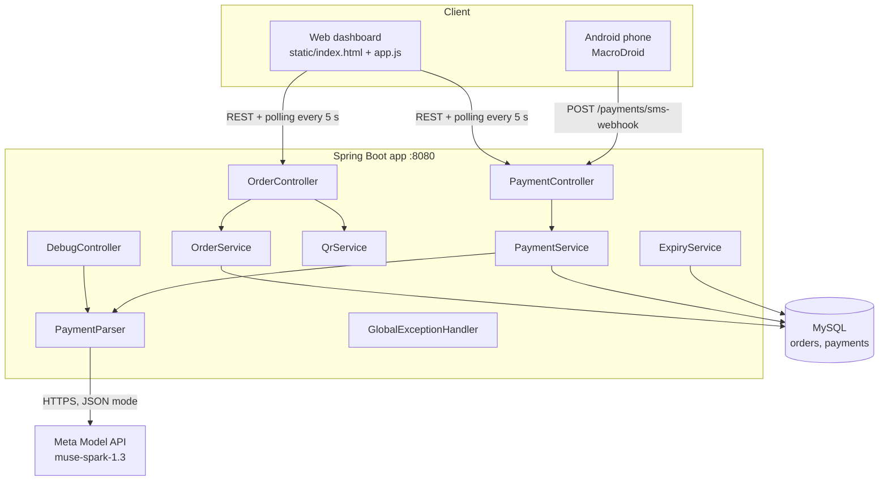
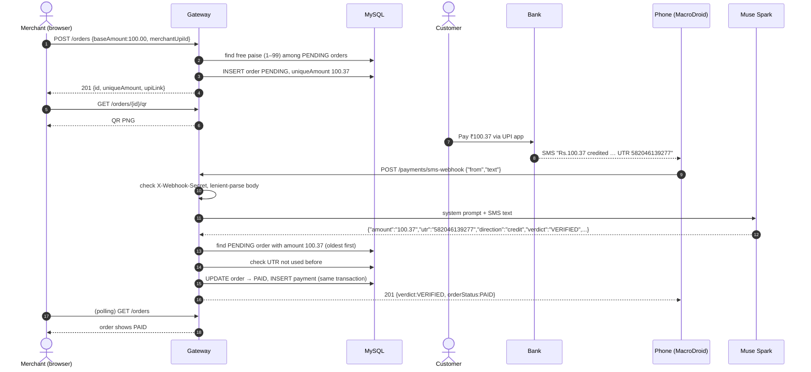
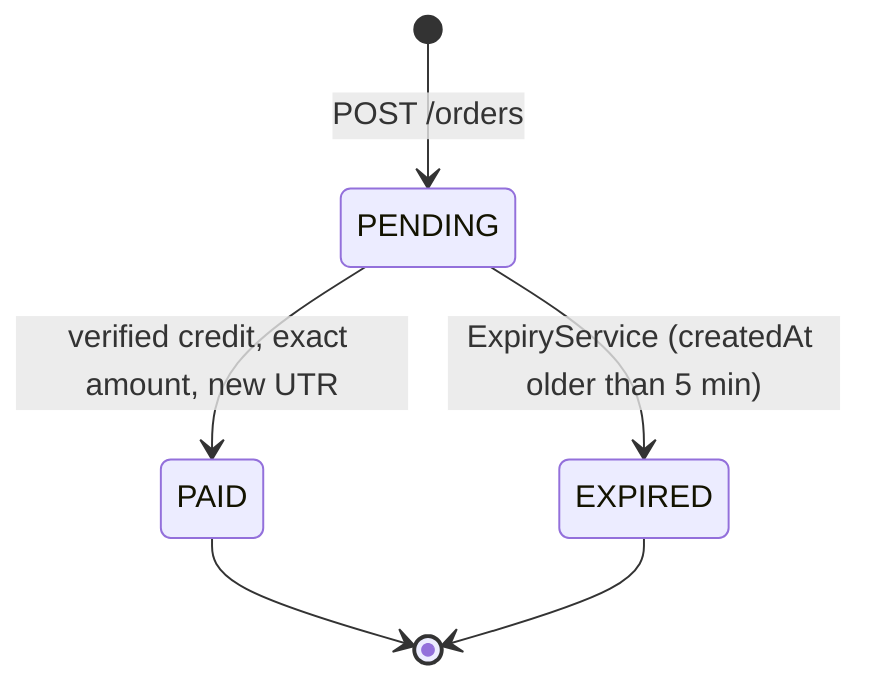
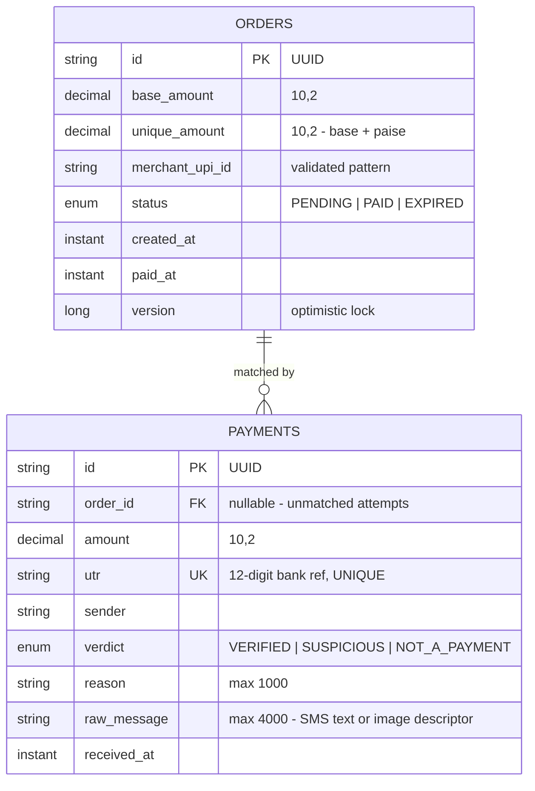

# UPI Payment Verification Gateway — Guide

Merchant creates a Rs.100 order → system assigns a unique amount (e.g. Rs.100.37;
the paise 0.01–0.99 is unused by any `PENDING` order) → UPI link + QR → customer
pays direct to the merchant UPI (we never hold money) → the bank SMS reaches
the app (phone auto-forward, paste, or screenshot upload) → Muse Spark
verifies → amount match flips the order
`PENDING` → `PAID`. Orders unpaid after 5 minutes become `EXPIRED`.


## Contents

1. [Prerequisites](#prerequisites) · [Setup](#setup) · [Run](#run)
2. [Demo script](#demo-script-5-minutes): browser, Android auto-SMS, manual fallback, curl
3. [API quick-ref](#api-quick-ref)
4. [How it works — technical deep dive](#how-it-works--technical-deep-dive):
   architecture, flow, lifecycle, data model, unique-amount algorithm,
   decision engine, AI parser, webhook, concurrency
5. [Configuration reference](#configuration-reference)
6. [Testing](#testing)
7. [Known limitations & roadmap](#known-limitations--roadmap)
8. [Troubleshooting](#troubleshooting)
9. [Project map](#project-map)

## Prerequisites

| Component | Version / note |
|---|---|
| OS | macOS, Linux or Windows |
| Java | JDK 17+ (tested on JDK 23) |
| Maven | 3.9+ |
| MySQL | 8.x on port 3306, or Docker Desktop |
| RAM | 4 GB+ is plenty |
| AI | Meta Model API key with `muse-spark-1.3` access |
| Optional | Android phone + MacroDroid (auto SMS), `curl` + `jq` (terminal demo), Node.js (`node --check app.js`) |

Details:

- Java 17+ (`java -version`) and Maven 3.9+ (`mvn -version`) — tested on JDK 23
- MySQL 8, running locally on port 3306 — or Docker Desktop for the
  `docker-compose.yml` alternative
- A Meta Model API key with access to `muse-spark-1.3`
- `curl` and `jq` for the demo script; any modern browser for the UI
- Node.js (only needed for the `node --check` syntax check on `app.js`)

## Setup

1. Start MySQL (pick one):

   ```bash
   # Option A — local MySQL 8 already installed: just make sure it is running
   mysql -uroot -p -e "SELECT 1;"   # enter your password, expect 1

   # Option B — Docker
   docker compose up -d
   docker logs upi-mysql            # wait until ready for connections
   ```

   The app URL contains `createDatabaseIfNotExist=true`, so the `paymentgateway`
   database is created automatically on first run.

2. If your MySQL user/password differ from `root` / `9599`, update them in
   `src/main/resources/application.properties`
   (`spring.datasource.username` / `spring.datasource.password`).

3. Get the API key value (provided with our submission — never committed to
   git) and sanity-check it:

   ```bash
   META_API_KEY=<key-from-us> python3 test.py   # should list muse-spark-1.3
   ```

## Run

```bash
mvn compile                                            # must pass with no errors
META_API_KEY=<key-from-us> mvn spring-boot:run        # app on http://localhost:8080
# + WEBHOOK_SECRET=<secret> prefix only if you use the Android macro
```

Open http://localhost:8080 for the demo UI
(`curl http://localhost:8080/ | grep -i "Built with Muse Spark"`).

One server serves everything: the UI and the API share port 8080 — no
separate frontend process, no CORS setup, one command to run.

Fast-expiry run (for testing the 5-minute window without waiting):

```bash
META_API_KEY=<key-from-us> mvn spring-boot:run -Dspring-boot.run.arguments="--app.expiry-minutes=1 --app.expiry-interval-ms=10000"
```

## Demo script (5 minutes)

### Judge demo — browser only (recommended)

You (the presenter) run Terminal 1 beforehand:
`META_API_KEY=<key-from-us> mvn spring-boot:run`.
Judges only touch http://localhost:8080 (no phone or macro setup needed —
paste/upload covers them):

1. **Create** — the form is prefilled (`100.00`, `shop@okaxis`); click Create
   Order. The result card shows the unique amount (e.g. `100.37`), the `upi://`
   link + Copy button, the QR code, status `PENDING`, and a 5:00 countdown.
2. **Pay** — scan the QR with any UPI app and pay the EXACT unique amount
   (or simulate — see below).
3. **Verify SMS** — paste the bank SMS into Verify SMS → Verify SMS. Green
   `VERIFIED` chip + amount/UTR/matched order; the order badge flips to `PAID`;
   both tables refresh within 5 s.
4. **Screenshot instead** — upload a payment screenshot (JPG/PNG ≤ 5 MB) for
   the same verdict panel.
5. **Expiry** — after 5 unpaid minutes the red *"Payment failed — time
   expired…"* banner appears with a Retry button that pre-fills the form.

### Auto SMS from Android (recommended for the video)

Your phone can push each SMS straight to the app — no pasting:

1. **Same network:** connect the phone to the same network as this laptop,
   then find the laptop's IP on that network — Mac: `ipconfig getifaddr en0`,
   Windows: `ipconfig`, Linux: `hostname -I`. Use YOUR OWN IP in step 4
   below, and re-check it if things ever stop working (IPs change).
2. **Install MacroDroid** (Play Store, free) and grant it SMS access when asked.
3. **Battery:** Android Settings → Apps → MacroDroid → Battery → Unrestricted,
   so Android can't kill it mid-demo.
4. **Create the macro:** Add Macro → Trigger `SMS Received` (any sender,
   content *Contains* `credited` so only payment SMS are forwarded) →
   Action `HTTP Request`: URL
   `http://<laptop-ip>:8080/payments/sms-webhook` (your IP from step 1),
   method `POST`,
   content type `application/json`, body
   `{"from":"<SMS-number magic text>","text":"<SMS-message magic text>"}`
   (insert both via the magic-text button: they appear as `[sms_number]` and
   `[sms_message]`). No constraints needed. Leave the `…` option menu on
   Cancel; picking an entry inserts an extra placeholder.
5. **macOS firewall:** on the first phone attempt the laptop may ask to allow
   incoming connections for Java — click Allow.
6. **Test:** text yourself any message → a new row appears in Payment History
   (non-payments land as `NOT_A_PAYMENT`/`SUSPICIOUS`, never matched). For a
   real match, FIRST create the order in the UI, then pay its EXACT unique
   amount — the forwarded SMS must carry that amount, or it lands as an
   unmatched audit row. Watch the order flip to `PAID` untouched.
7. **Optional security:** to stop strangers on the network hitting your
   webhook, pick ANY value you like and put the SAME value in both places:
   prefix the run command with `WEBHOOK_SECRET=<your-value>` and add a header
   `X-Webhook-Secret: <your-value>` in MacroDroid's HTTP Request headers.
   The two just have to match each other — not anyone else's. Leave the env
   var unset and the endpoint is open (fine for judging, where no macro is
   used at all). The server never fails on malformed JSON: raw quotes, newlines, and
   backslashes in the SMS are handled, and even a plain-text body is treated
   as the SMS.

### Manual fallback (no phone setup)

- **Paste:** read the bank SMS on your phone, copy/type its text into the
  Verify SMS box, submit. That text goes straight to the AI parser, and the
  result is saved to the `payments` table.
- **Same-network browser:** open `http://<laptop-ip>:8080` in the phone's
  browser and paste the SMS directly — no retyping.
- **Screenshot:** screenshot the payment → transfer it to the laptop (AirDrop,
  message-to-self, USB) → upload it in Verify Screenshot.
- **Simulated SMS (no real payment):** paste
  `Rs.<uniqueAmount> credited to A/c XX1234 via UTR <random-12-digit> from buyer@okaxis`
  using the EXACT amount shown on screen and a fresh random-looking UTR each
  run. Avoid obviously fake UTRs (`123456789012`, `777788889999`, …) — the
  model flags sequential/repetitive patterns as fabricated.

### Terminal demo — curl (same flow, for API checking)

Terminal 1: `META_API_KEY=<key-from-us> mvn spring-boot:run`.
Terminal 2:

```bash
# 1. Create an order — note the uniqueAmount, e.g. 100.37
RESP=$(curl -s -X POST http://localhost:8080/orders \
  -H "Content-Type: application/json" \
  -d '{"baseAmount":"100.00","merchantUpiId":"shop@okaxis"}')
echo $RESP | jq
OID=$(echo $RESP | jq -r .id)
AMT=$(echo $RESP | jq -r .uniqueAmount)

# 2. Pay Rs.$AMT to shop@okaxis from your phone (use the QR in the UI),
#    then verify with the bank SMS the merchant received.
#    Use a fresh random UTR every run — reusing one returns "Duplicate UTR":
UTR=$(python3 -c 'import random; print(random.randrange(10**11, 10**12))')
curl -s -X POST http://localhost:8080/payments/verify \
  -H "Content-Type: application/json" \
  -d "{\"smsText\":\"Rs.$AMT credited to A/c XX1234 via UTR $UTR from buyer@okaxis\"}" | jq
# expect verdict VERIFIED, matchedOrderId == $OID, orderStatus PAID

curl -s http://localhost:8080/orders/$OID | jq .status   # PAID

# 3. Non-payment SMS is audited, never matched:
curl -s -X POST http://localhost:8080/payments/verify \
  -H "Content-Type: application/json" \
  -d '{"smsText":"Your OTP is 482910"}' | jq .verdict    # NOT_A_PAYMENT

# 4. Screenshot path (JPG/PNG, max 5MB):
curl -s -X POST http://localhost:8080/payments/verify-image \
  -F "image=@/tmp/pay.jpg" | jq

# 5. History:
curl -s http://localhost:8080/orders | jq length
curl -s "http://localhost:8080/payments?orderId=$OID" | jq length
```

In the browser: create → QR + 5-min countdown → verify SMS → green `VERIFIED`
chip; orders table and payment history refresh every 5 s. After expiry the UI
shows *"Payment failed — time expired…"* with a Retry button that pre-fills the
create form.

## API quick-ref

| Method & path | Body | Success |
|---|---|---|
| `POST /orders` | `{"baseAmount":"100.00","merchantUpiId":"shop@okaxis"}` | `201` `OrderResponse` (`id`, `uniqueAmount`, `upiLink`, …) |
| `GET /orders` | — (`?status=PENDING\|PAID\|EXPIRED` optional) | `200` list |
| `GET /orders/{id}` | — | `200` `OrderResponse`, `404` unknown |
| `GET /orders/{id}/qr` | — | `200` `image/png` (220×220), `404` unknown |
| `POST /payments/verify` | `{"smsText":"…"}` | always `201` `VerifyPaymentResponse` — branch on `verdict` / `orderStatus`, never on status code |
| `POST /payments/verify-image` | multipart `image` (JPEG/PNG ≤ 5 MB) | always `201` `VerifyPaymentResponse` |
| `POST /payments/sms-webhook` | `{"from":"…","text":"…"}` (aliases + tolerant parse of raw quotes/newlines; plain text also OK) | always `201` — Android forwarder target; optional `X-Webhook-Secret` header (`401` on mismatch when `WEBHOOK_SECRET` is set) |
| `GET /payments` | — (`?orderId=` optional) | `200` list, newest first |
| `POST /debug/parse` | `{"smsText":"…"}` | `200` raw `ParsedResult` (dev only) |

Error shape (all errors): `{"timestamp","status","error","message","path"}`.
`400` validation / bad param / bad image, `401` bad webhook secret, `404`
unknown order, `409` paise exhaustion or write race, `413` image over 5 MB.

Money is `BigDecimal` (scale 2) end to end; UTR is normalized `""` → `null` and
unique; every verify attempt is saved as a `payments` audit row, including
duplicates and races (re-saved as `SUSPICIOUS`).

## How it works — technical deep dive

This section explains what happens inside the gateway, from the moment an order
is created to the moment it is marked `PAID`.

### Architecture



| Component | Responsibility |
|---|---|
| `OrderController` | Create/list/fetch orders, serve QR PNG |
| `PaymentController` | Verify SMS, verify screenshot, SMS webhook (secret check + lenient parsing), payment history; catches write races and saves a fallback audit row |
| `OrderService` | Picks the unique amount, builds the `upi://pay` link |
| `QrService` | Renders the UPI link as a 220×220 PNG (ZXing) |
| `PaymentParser` | Calls Muse Spark; turns its JSON into a `ParsedResult`; returns `SUSPICIOUS` instead of throwing on parse/network failures |
| `PaymentService` | The decision engine: validate → match → settle → audit, inside one transaction |
| `ExpiryService` | Every 60 s, marks `PENDING` orders older than 5 min as `EXPIRED` |
| `GlobalExceptionHandler` | Turns every error into the same JSON shape |

### End-to-end flow



### Order lifecycle



There is no way back from `PAID` or `EXPIRED`. Once an order expires its amount
becomes free again for new orders. A late payment for an expired order is
recorded as `SUSPICIOUS` and linked to the expired order, so the merchant can
refund or follow up.

### Data model



- `payments.order_id` is empty for attempts that didn't match any order. They're
  still stored for auditing.
- `payments.utr` is `UNIQUE`. One real bank transfer can never settle two orders,
  even if the same SMS is submitted twice.
- Tables are created automatically by Hibernate (`ddl-auto=update`). See
  `README_MYSQL.md` for querying them directly.

### The unique-amount algorithm

```
createOrder(base, upiId):            # synchronized: one at a time
    base = round(base, 2)
    repeat up to 100 times:
        paise = random(1..99)
        candidate = base + paise/100
        if no PENDING order has uniqueAmount == candidate:
            save order(candidate, PENDING); return it
    fail with 409 "All paise variants in use"
```

- Up to **99 orders with the same base amount** can be pending at once. In
  practice the 5-minute expiry keeps that number small.
- The customer pays at most ₹0.99 extra. That's a tiny cost for exact matching
  without fees.
- `synchronized` stops two requests that arrive at the same moment from picking
  the same amount.

### The verification decision engine

Each verify request (pasted SMS, webhook SMS or screenshot) goes through
`PaymentService.matchAndSettle`. Rules are checked top to bottom, and the first
one that applies decides the outcome. **Every path saves an audit row.**

| # | Condition | Result saved | Order effect |
|---|---|---|---|
| 1 | AI verdict is not `VERIFIED`, or no amount found | AI's verdict + reason | none |
| 2 | Source is SMS and direction is not `credit` | AI's verdict (unmatched) | none |
| 3 | No `PENDING` order has this amount, but an `EXPIRED` one does | `SUSPICIOUS` — "Order expired — 5 min window passed…" | linked to expired order (stays `EXPIRED`) |
| 4 | No `PENDING` or `EXPIRED` order has this amount | `VERIFIED`, unmatched | none |
| 5 | UTR already used by an earlier payment | `SUSPICIOUS` — "Duplicate UTR" (UTR blanked in the audit row) | none |
| 6 | Otherwise | `VERIFIED` | **oldest matching `PENDING` order → `PAID`** |

Why rule 2 applies only to SMS: the merchant's bank SMS must say money came
**in**. A customer's screenshot, though, shows money going **out** (a debit from
their side), so screenshots accept either direction.

### AI parser design (`PaymentParser`)

- **Model:** `muse-spark-1.3` via the OpenAI-compatible `POST {baseUrl}/chat/completions`.
- **Deterministic output:** `temperature: 0` and `response_format: {"type":"json_object"}`.
- **Prompt:** asks for `amount, utr, sender, time, direction, verdict, reason`. It
  tells the model to *judge only the message content; there is no expected
  amount*, so it can't be nudged into "agreeing" with an order.
- **Screenshots:** the same fields, sent as a base64 `image_url` data URL to the
  same model's vision input.
- **Post-processing:** removes ```` ``` ```` fences if the model adds them, reads the
  amount as `BigDecimal`, accepts the UTR only if it's exactly 12 digits, and
  maps unknown verdicts to `SUSPICIOUS`.
- **Fail closed:** a missing key, timeout (30 s), non-2xx response or unreadable
  JSON gives `SUSPICIOUS` with "Verification service unavailable". The parser
  never approves a payment on error.
- **Debugging:** `POST /debug/parse` returns the raw `ParsedResult` without
  touching the database.

### SMS webhook internals

MacroDroid pastes the SMS into the JSON body **without escaping it**, so a real
message with a `"`, a backslash or a line break produces invalid JSON.
`SmsWebhookRequest.lenientParse` handles this in three tiers:

1. **Strict JSON.** It parses normally. The message can be named `text`,
   `message`, `body` or `sms`, and the sender `from`, `sender`, `address` or
   `number`.
2. **Tolerant extraction.** If strict parsing fails, it takes everything between
   the `"text":"` key and the final closing quote, and turns line breaks into
   spaces.
3. **Plain text.** If neither works, it treats the whole body as the SMS.

The endpoint first checks the `X-Webhook-Secret` header (only when
`WEBHOOK_SECRET` is set), then parses leniently and passes the text to the
same verify path as `/payments/verify`. It returns `400` only when there is
no text at all. The sender (`from`) is
accepted but not used yet. Only the message text is verified.

### Concurrency & data safety

| Risk | Protection |
|---|---|
| Two orders get the same amount | `createOrder` is `synchronized`, and it checks for a pending duplicate before saving |
| The same SMS submitted twice (retry, double-tap) | `UNIQUE(utr)`; the second attempt is saved as `SUSPICIOUS — Duplicate UTR` |
| Two SMS race to pay the same order | `@Version` optimistic lock on `Order`; the loser hits `OptimisticLockingFailureException` |
| A race loser's audit row disappears | The controller catches the conflict and saves a fresh `SUSPICIOUS — Payment already processed` row in a new transaction |
| A half-finished settle (order PAID, payment missing) | `@Transactional`: the order update and payment insert commit together or not at all |
| Rounding errors | `BigDecimal` with scale 2 everywhere: DB columns, parsing, comparison |
| Huge AI reason or SMS breaks the insert | Text is trimmed to the column size (1000 / 4000) before saving |
| Leaking internal entities | Controllers return DTOs only |

## Configuration reference

All settings live in `src/main/resources/application.properties`. Any of them
can be overridden at startup with `--key=value`, for example
`mvn spring-boot:run -Dspring-boot.run.arguments="--app.expiry-minutes=1"`.

| Property | Default | Purpose |
|---|---|---|
| `server.port` | `8080` | HTTP port for the API and UI |
| `spring.datasource.url` | `jdbc:mysql://localhost:3306/paymentgateway?createDatabaseIfNotExist=true…` | DB connection (creates the DB on first run) |
| `spring.datasource.username` / `password` | `root` / `9599` | DB credentials |
| `meta.api.key` | `${META_API_KEY:}` (empty default) | Muse Spark API key — **environment variable only** |
| `meta.api.baseUrl` | `https://api.meta.ai/v1` | Meta Model API base URL |
| `meta.api.model` | `muse-spark-1.3` | Model used for text and vision |
| `webhook.secret` | `${WEBHOOK_SECRET:}` (empty = open) | Required `X-Webhook-Secret` value for the SMS webhook |
| `app.expiry-minutes` | `5` | How long an order stays `PENDING` |
| `app.expiry-interval-ms` | `60000` (default lives in `ExpiryService` code, not in the properties file) | How often the expiry job runs |
| `spring.servlet.multipart.max-file-size` | `5MB` | Screenshot upload limit |

| Environment variable | Required? | Used for |
|---|---|---|
| `META_API_KEY` | **Yes** (otherwise every verify returns `SUSPICIOUS`) | AI parsing |
| `WEBHOOK_SECRET` | Optional | Protecting `/payments/sms-webhook` |

## Testing

```bash
mvn test
```

The tests use fakes, so they need **no database and no AI key**:

| Test class | What it proves |
|---|---|
| `PaymentServiceTest` | A duplicate-UTR audit is saved with the UTR blanked, so `UNIQUE(utr)` holds; a **debit SMS never settles** an order, but a debit **screenshot** does |
| `SmsWebhookRequestTest` | The webhook accepts normal and alias field names, an optional sender, valid JSON, **raw quotes/newlines/backslashes**, alias keys with raw content, and plain-text bodies, and returns `null` for an empty body |

The manual end-to-end checks (create, pay, verify, expire, duplicate) are in the
demo script above.

## Known limitations & roadmap

Each limitation below has a known fix:

| Limitation | Why it matters | Planned fix |
|---|---|---|
| The AI verdict is the only authenticity check | An SMS crafted to look genuine could be marked `VERIFIED` | Add rule checks: amount must appear in the raw text, sender must be a bank sender ID, UTR format |
| Screenshots can settle an order | Screenshots can be edited | Treat screenshot verdicts as "needs review"; settle only from bank SMS |
| Single merchant / no auth | Anyone who can reach the server can create orders | Per-merchant API keys; match verify requests by merchant |
| An expired amount is reused right away | A late payment could match a *new* order with the same amount | Cooldown before a freed amount can be assigned again |
| Runs on a laptop + local network | The phone must share a network with the laptop | Cloud deployment with a public HTTPS webhook |
| UPI link has no payee name (`pn=`) | Some UPI apps show a warning | Add a merchant display name to the link |


## Troubleshooting

- **App won't start / access-denied for `root`**: MySQL isn't up or the
  password differs — check `docker ps` (Option B) or
  `mysql -uroot -p -e "SELECT 1;"`, then fix `spring.datasource.*`.
- **`Verification service unavailable` verdict**: `META_API_KEY` missing/invalid
  or Meta API unreachable. Re-check with
  `META_API_KEY=<key-from-us> python3 test.py`, then restart the app with the
  key inline (see Run above).
- **`Order expired — 5 min window passed`**: correct behavior — create a new
  order (new unique amount) and pay again. For tests, use the fast-expiry run
  above.
- **`Duplicate UTR`**: that UTR was already used for a matched payment; each
  payment needs its own UTR.
- **Test SMS came back `SUSPICIOUS` instead of `VERIFIED`**: your test UTR
  looks fabricated (sequential or repetitive digits) — use a fresh
  random-looking 12-digit UTR.
- **`413 File too large`**: screenshot over 5 MB — compress/resize and retry.
- **`409 All paise variants in use`**: 99+ `PENDING` orders share one base
  amount — wait for expiry or vary the base amount.
- **QR shows but phone won't open it**: the `upi://` link needs a UPI app
  (GPay/PhonePe/Paytm) on the scanning phone; on desktop use the Copy button.
- **Countdown hit 00:00 but status still `PENDING`**: the timer is display-only;
  the server expires every ~60 s — the UI polls and updates shortly after.
- **Port 8080 already in use**: start on another port —
  `mvn spring-boot:run -Dspring-boot.run.arguments="--server.port=8081"`,
  then open http://localhost:8081 instead.
- **SMS arrived but no payment row appeared**: phone and laptop must share one
  network — re-check the laptop IP (`ipconfig getifaddr en0`) and the macro
  URL; confirm MacroDroid battery is Unrestricted and the app is running with
  the key inline (see Run above).
- **macOS blocked the phone's connection**: allow incoming connections for
  Java when prompted (or Settings → Network → Firewall).
- **Row appears but the order stays `PENDING`**: read that row's verdict and
  reason — it names the exact cause (amount mismatch, flagged UTR, expired
  order). The SMS must carry the order's EXACT unique amount.
- **College/public WiFi blocks phone → laptop**: some networks isolate
  clients from each other. Fallback: turn on the phone's hotspot, join it
  from the laptop, and use the hotspot IP in the macro (USB tethering works
  the same way). Paste always works regardless of network.
- **Webhook returns `401`**: you set `WEBHOOK_SECRET` but MacroDroid's
  `X-Webhook-Secret` header is missing or different — make them match, or
  unset the env var and restart to leave the endpoint open.

## Project map

```
pom.xml                                  Spring Boot 3.2 / Java 17 / MySQL / ZXing
src/main/java/com/example/upigateway/
  UpiGatewayApplication.java             boot + @EnableScheduling
  model/      Order, Payment, OrderStatus, Verdict, ParsedResult
  repo/       OrderRepository, PaymentRepository (UTR unique, earliest-first match)
  dto/        CreateOrderRequest, OrderResponse, VerifySmsRequest, VerifyPaymentResponse,
              SmsWebhookRequest (lenient forwarder-body parse)
  service/    OrderService (unique paise + upi:// link), QrService (220px PNG),
              ExpiryService (5-min scheduler), PaymentParser (Muse Spark SMS+vision),
              PaymentService (@Transactional audit + match/settle)
  controller/ OrderController, PaymentController (race-loss fallback audits),
              DebugController (POST /debug/parse)
  config/     GlobalExceptionHandler (JSON error shape)
src/main/resources/
  application.properties                 DB, Meta API, expiry, 5MB upload cap
  static/     index.html, app.js, style.css (demo UI, no framework)
src/test/...   PaymentServiceTest, SmsWebhookRequestTest (no DB/AI, `mvn test`)
docker-compose.yml  MySQL 8 (Option B)    README_MYSQL.md  DB deep-dive
PLAN.md         build plan (source of truth)  test.py  API-key probe
```

Rules the code follows: `BigDecimal` money (never `double`), controllers return
DTOs (never entities), `@Transactional` all-or-nothing settle, every payment
audited, footer “Built with Muse Spark”.
