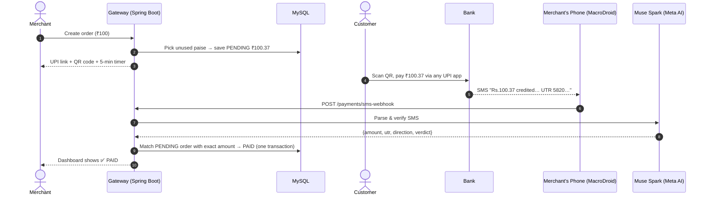
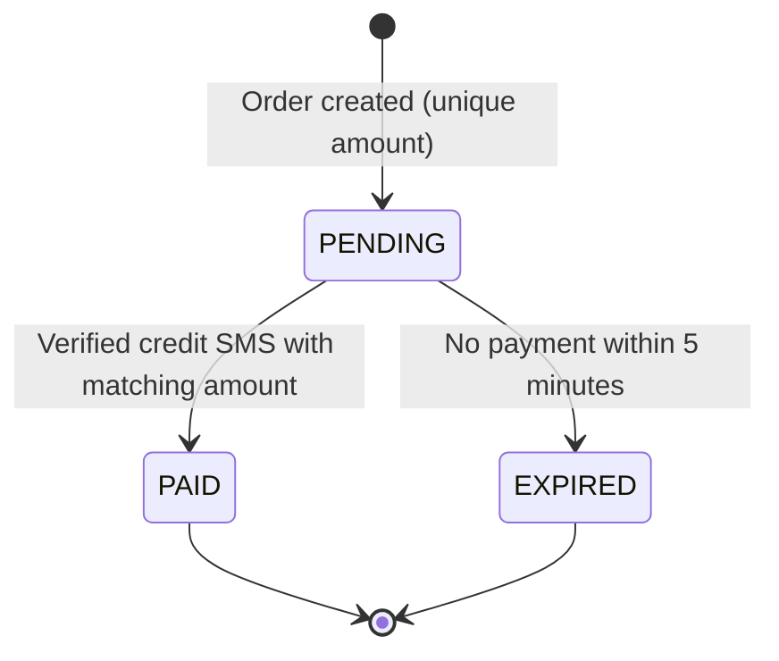
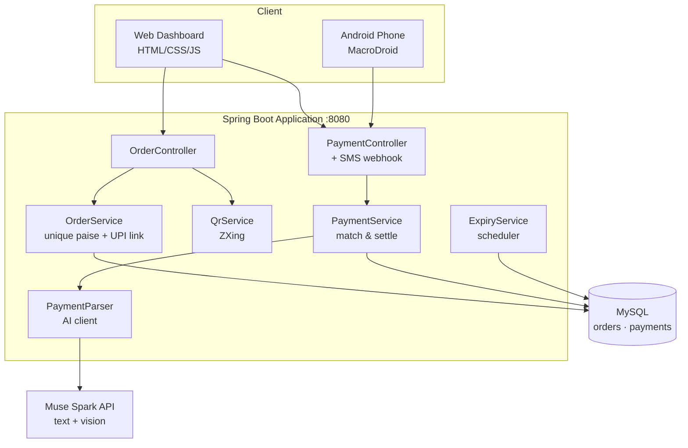

<div align="center">

# 💸 UPI Payment Verification Gateway

### Zero-fee UPI payments with automatic AI verification

**Customers pay straight into the merchant's own UPI account, and the gateway uses Meta's Muse Spark to confirm each payment and mark the right order paid. It never holds the money.**


[The Problem](#-the-problem) · [The Solution](#-the-solution) · [System Flow](#-system-flow) · [Architecture](#%EF%B8%8F-architecture) · [Requirements](#-system-requirements) · [Quick Start](#-quick-start) · [Full Guide](GUIDE.md)

</div>

---

## 🧩 The Problem

Millions of small businesses in India, from tea stalls and tutors to home bakers and Instagram sellers, take payments over **UPI**. Payments to a personal UPI ID are free and instant, but the merchant can't easily tell **which customer paid for which order**.

| Today's options | Downside |
|---|---|
| Check every bank SMS by hand | Slow, error-prone, impossible at scale |
| Ask customers for a screenshot | Screenshots are easy to fake |
| Use a payment aggregator (Razorpay, Cashfree, …) | ~2% fee per transaction, KYC paperwork, settlement delays |

**There's no free, automatic way to reconcile direct UPI payments with orders.**

---

## 💡 The Solution

Three simple ideas work together:

1. **🔢 Unique amounts.** Each order gets a random paise value that no other pending order is using, so a ₹100 order becomes **₹100.37**. The amount itself identifies the order.
2. **🤖 AI verification.** When the bank's "credited" SMS arrives, **Muse Spark** reads it, extracts the amount, UTR and direction, and judges whether it looks genuine.
3. **📲 Automatic forwarding.** An Android phone forwards bank SMS to the gateway in real time, so orders settle with **no human involved**.

> **Result:** the customer scans a QR code, pays with any UPI app, and the order flips to `PAID` within seconds. There's no aggregator, no fees, and the gateway never touches the money.

---

## 🔄 System Flow



**Order lifecycle**



---

## 🏗️ Architecture



---

## ✨ Key Features

| Feature | What it does |
|---|---|
| 🔢 **Unique-paise matching** | No two pending orders share an amount, so every payment maps to exactly one order |
| 📷 **UPI QR + deep link** | Works with GPay, PhonePe, Paytm and any other UPI app |
| 🤖 **AI SMS parsing** | Muse Spark extracts amount, UTR, sender and direction, and returns a verdict (`VERIFIED` / `SUSPICIOUS` / `NOT_A_PAYMENT`) |
| 🖼️ **Screenshot verification** | Upload a payment screenshot, read by Muse Spark's vision model |
| 📲 **Real-time SMS webhook** | Fully automatic settlement from a real bank SMS; tolerates messy text with raw quotes and newlines |
| 🛡️ **Fraud protection** | Rejects duplicate UTRs, ignores debit SMS, flags late payments to expired orders, catches fake-looking UTRs |
| ⏱️ **Auto-expiry** | A scheduler expires unpaid orders after 5 minutes and frees their amount |
| 📜 **Full audit trail** | Every verification attempt is stored, even failed, duplicate or suspicious ones |
| 🔐 **Webhook secret** | Optional shared-secret header blocks forged SMS posts |

---

## 📋 System Requirements

### Functional requirements

| ID | Requirement |
|---|---|
| FR-1 | A merchant can create an order with a base amount and their UPI ID |
| FR-2 | The system assigns a unique payable amount (base + 1–99 paise) not used by any other pending order |
| FR-3 | The system generates a UPI deep link and a scannable QR code for each order |
| FR-4 | The system verifies payments from a pasted bank SMS, a forwarded SMS (webhook) or a screenshot |
| FR-5 | A verified credit whose amount matches a pending order marks that order `PAID` |
| FR-6 | Orders unpaid after 5 minutes are marked `EXPIRED` automatically |
| FR-7 | Every verification attempt is recorded with its verdict and reason |
| FR-8 | The dashboard shows live order status and payment history |

### Non-functional requirements

| Category | Requirement |
|---|---|
| **Correctness** | Money stored as `BigDecimal` (scale 2), never floating point |
| **Integrity** | Each UTR is unique in the database, so one payment can never settle two orders |
| **Concurrency** | Order creation is synchronized; settlement is transactional with optimistic locking (`@Version`) |
| **Reliability** | If the AI service fails, the payment is recorded as `SUSPICIOUS`, never auto-approved |
| **Security** | API keys and secrets come only from environment variables; optional webhook secret |
| **Robustness** | The webhook accepts malformed JSON and plain text without crashing |
| **Usability** | One command starts the API and UI together on one port; no build step for the frontend |

### Requirements to run it

| Component | Requirement |
|---|---|
| OS | macOS, Linux or Windows |
| Java | JDK 17 or newer (tested on JDK 23) |
| Build tool | Maven 3.9+ |
| Database | MySQL 8 (local install, or Docker via the included `docker-compose.yml`) |
| AI access | Meta Model API key with access to `muse-spark-1.3` |
| Hardware | Any laptop with 4 GB+ RAM |
| Optional | Android phone with MacroDroid for automatic SMS forwarding |

---

## 🛠️ Tech Stack

| Layer | Technology | Why |
|---|---|---|
| Language | **Java 17** | Strong typing and `BigDecimal` for money |
| Framework | **Spring Boot 3.2** | REST APIs, scheduling, transactions, validation |
| Persistence | **Spring Data JPA + MySQL 8** | Relational integrity, unique constraints, optimistic locking |
| AI | **Muse Spark 1.3 (Meta Model API)** | Understands free-form bank SMS and screenshots; JSON output mode |
| QR codes | **ZXing** | Standard library for generating QR PNGs |
| Frontend | **Vanilla HTML/CSS/JS** | Zero build step, served by Spring Boot |
| Automation | **MacroDroid (Android)** | Forwards bank SMS to the webhook |

---

## 🧠 Engineering Decisions

- **Why unique paise instead of asking customers for a reference note?** Many UPI apps don't pass the note through to bank SMS, but the amount always appears. Encoding the order in the amount makes matching reliable.
- **Why an LLM instead of regex?** Every bank formats SMS differently and changes formats often. One AI parser handles all of them, plus screenshots, without per-bank rules.
- **Why fail closed?** If the AI is down or unsure, the payment is saved as `SUSPICIOUS` for review. Money logic should never guess in the customer's favour.
- **Why save every attempt?** A payment system needs a complete audit trail for disputes, debugging and fraud analysis.
- **Why a lenient webhook?** MacroDroid inserts SMS text unescaped, so real bank messages with quotes or line breaks would otherwise be lost.

---

## 🚀 Quick Start

```bash
# 1. Clone
git clone https://github.com/chitpoo/Custom-Upi-based-payment-Gateway.git
cd Custom-Upi-based-payment-Gateway

# 2. Start MySQL (skip if you have it installed locally)
docker compose up -d

# 3. Run
export META_API_KEY=<your-key>
mvn spring-boot:run
```

Open **http://localhost:8080**. Create an order, scan the QR code, pay, and verify. 🎉

📖 Step-by-step setup, the Android SMS forwarder, the API reference, the internals and troubleshooting are all in **[GUIDE.md](GUIDE.md)**.

---

## 🔌 API at a Glance

| Method | Endpoint | Description |
|---|---|---|
| `POST` | `/orders` | Create an order and get its unique amount and UPI link |
| `GET` | `/orders` | List orders (`?status=PENDING\|PAID\|EXPIRED`) |
| `GET` | `/orders/{id}/qr` | Get the UPI QR code as a PNG |
| `POST` | `/payments/verify` | Verify a pasted bank SMS |
| `POST` | `/payments/verify-image` | Verify a payment screenshot |
| `POST` | `/payments/sms-webhook` | Real-time SMS forwarder endpoint |
| `GET` | `/payments` | Payment audit history |

---

## 🗂️ Project Structure

```
src/main/java/com/example/upigateway/
├── controller/   REST endpoints: orders, payments, SMS webhook
├── service/      OrderService · PaymentService · PaymentParser · ExpiryService · QrService
├── model/        Order · Payment · OrderStatus · Verdict · ParsedResult
├── dto/          Request/response objects (entities never leave the server)
├── repo/         Spring Data repositories
└── config/       Uniform JSON error handling
src/main/resources/static/   Dashboard UI
src/test/                    Unit tests (matching rules + webhook parsing)
```

---

## 🔭 Limitations & Roadmap

- [ ] Add rule-based checks alongside the AI verdict (amount must appear in SMS text, sender must be a bank ID)
- [ ] Treat screenshots as "needs review" instead of auto-settling, since screenshots can be edited
- [ ] Multi-merchant support with per-merchant API keys
- [ ] Cloud deployment with a public HTTPS webhook
- [ ] Cooldown before an expired order's amount can be reused
- [ ] Webhooks or email to notify merchants when an order is paid

---

<div align="center">

**Built solo for the Meta AI Hackathon 2026** · Powered by **Muse Spark** 🤖

⭐ If you found this interesting, consider starring the repo!

</div>
